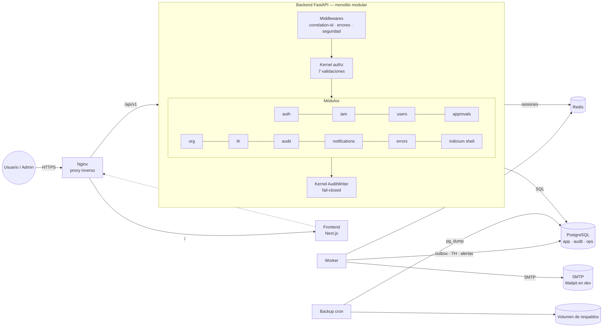
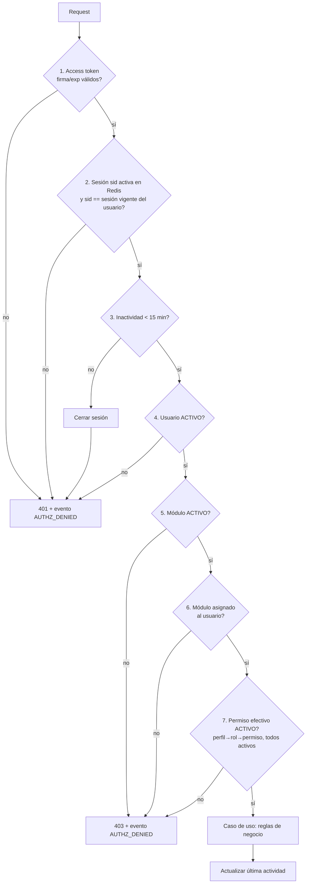
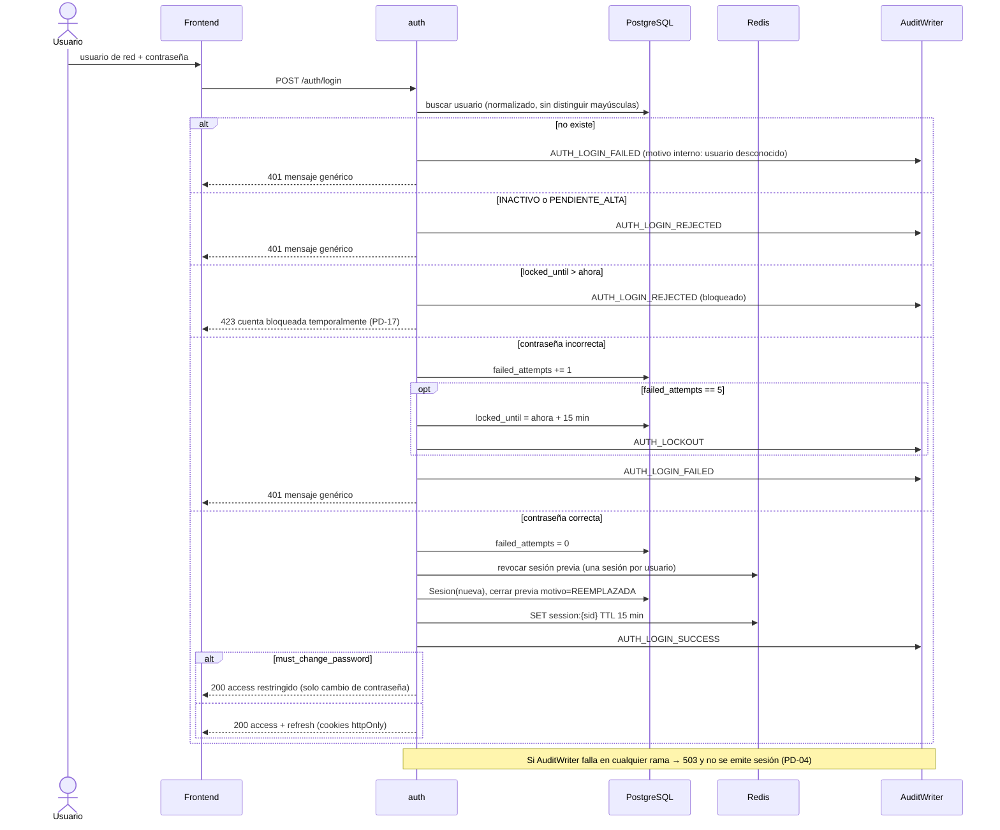
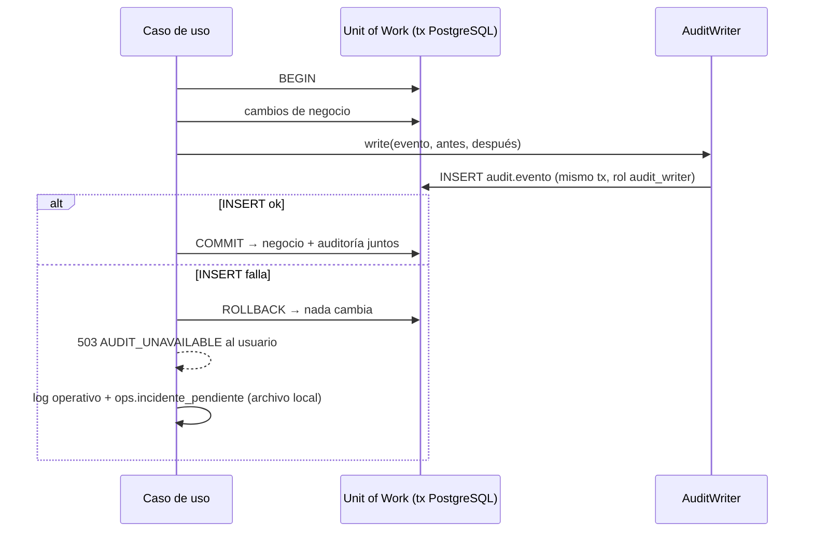
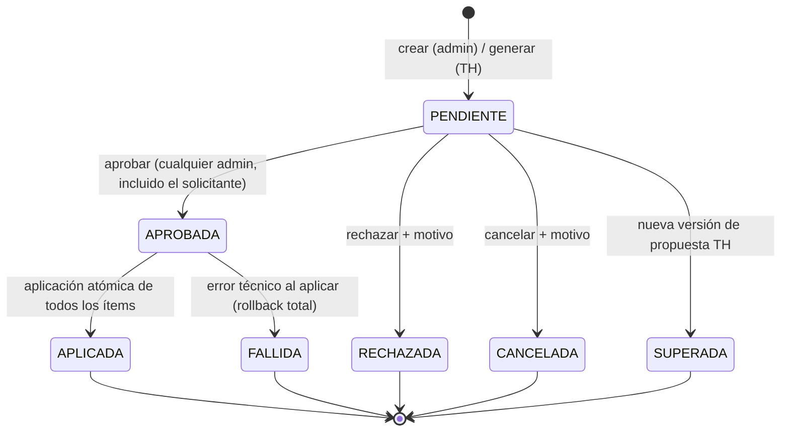
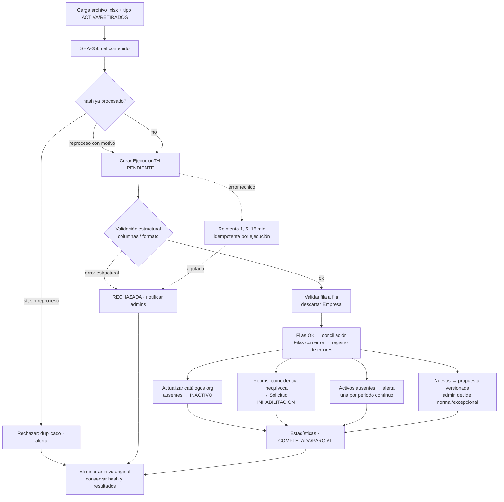
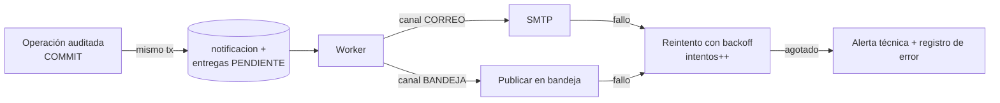

# B. Arquitectura lógica y estructura de carpetas · C. Componentes y flujos

> **PROPUESTA TÉCNICA A VALIDAR.** El stack es APROBADO (D-ARCH-001). La forma de organizarlo (monolito modular, worker, patrón de sesiones, outbox) es PROPUESTA.

## B.1 Estilo arquitectónico

**Monolito modular** en el backend (PROPUESTO). Es un único despliegue FastAPI con módulos de dominio aislados, que comparten un *kernel* transversal: seguridad, auditoría, errores y notificaciones.

| Alternativa | Ventaja | Desventaja | Recomendación |
|---|---|---|---|
| **Monolito modular** | Transacciones ACID entre negocio y auditoría (permite el fail-closed real), simple de operar en un PC | Disciplina de límites entre módulos | **Recomendada** |
| Microservicios por módulo | Despliegue independiente | Auditoría fail-closed distribuida (sagas/2PC), excesivo para el piloto local | No |

Reglas de modularidad (cubren REQ-GEN-04):
1. Cada módulo (`auth`, `iam`, `users`, `approvals`, `audit`, `notifications`, `errors`, `th`, `org`, `indicium`) expone **servicios de aplicación**; ningún módulo importa repositorios de otro.
2. La comunicación entre módulos va por servicios de aplicación o por **eventos de dominio en proceso** (p. ej., `UserDeactivated` → `auth` revoca sesiones).
3. Las capas de cada módulo son `api` (routers/DTO) → `application` (casos de uso) → `domain` (entidades y reglas puras) → `infrastructure` (SQLAlchemy y adaptadores).
4. Un módulo nuevo (roadmap) = una carpeta nueva + un registro en la tabla `modulo` + sus permisos, sin tocar el núcleo.

## B.2 Contenedores (Docker Compose)

| Servicio | Imagen/base | Rol | Expuesto |
|---|---|---|---|
| `nginx` | nginx:stable-alpine | Proxy inverso, TLS local (PD-20), cabeceras de seguridad, límite de tamaño de subida | **Sí** (único puerto publicado) |
| `frontend` | node LTS + Next.js (standalone) | UI SSR/CSR | Solo red interna |
| `backend` | python 3.12 + FastAPI/Uvicorn | API REST `/api/v1` | Solo red interna |
| `worker` | misma imagen que backend | Outbox de notificaciones, reintentos, tareas programadas TH, alertas, purga de archivos TH | No |
| `postgres` | postgres 16 | Persistencia; esquemas `app`, `audit` y `ops` | No (opcional en dev) |
| `redis` | redis 7 | Sesiones activas y estado efímero (PD-01) | No |
| `mailpit` *(solo dev/test)* | axllent/mailpit | SMTP simulado para probar el correo sin servidor real (PD-11) | UI en dev |
| `backup` *(perfil `ops`)* | postgres 16 + cron | `pg_dump` programado y rotación 7d/4s/3m | No |

Las versiones exactas de las imágenes se fijarán en la Fase 1 (digest/tag inmutable).

## B.3 Estructura de carpetas (monorepo, PROPUESTO — PD-13)

```text
secureone/
├── .github/workflows/          # ci.yml (lint, tests, build), security.yml (deps/SAST)
├── docs/                       # este diseño + manuales de operación
├── infra/
│   ├── nginx/                  # nginx.conf, cabeceras, certs dev (no versionados)
│   ├── postgres/init/          # creación de roles: app_rw, audit_writer, audit_reader
│   └── backup/                 # scripts pg_dump / restore / rotación
├── backend/
│   ├── pyproject.toml
│   ├── alembic.ini
│   ├── migrations/             # Alembic versionado (REQ-RNF-04)
│   ├── app/
│   │   ├── main.py             # factory FastAPI, routers, middlewares
│   │   ├── worker.py           # entrypoint del worker
│   │   ├── cli.py              # bootstrap-admins, rotate, etc.
│   │   ├── core/               # config (pydantic-settings), db, redis, logging,
│   │   │                       # security (hash, jwt), errors, correlation-id
│   │   ├── kernel/
│   │   │   ├── authz.py        # dependencia require(permission, module)  ← REQ-IAM-05
│   │   │   ├── audit.py        # AuditWriter transaccional fail-closed     ← REQ-AUD-07
│   │   │   ├── events.py       # bus de eventos de dominio en proceso
│   │   │   └── unit_of_work.py
│   │   └── modules/
│   │       ├── auth/           # login, refresh, logout, cambio de contraseña, sesiones
│   │       ├── iam/            # perfiles, roles, permisos, módulos, dominios
│   │       ├── users/          # usuarios, consulta, exportación
│   │       ├── org/            # gerencias, áreas, cargos (solo lectura + sync TH)
│   │       ├── approvals/      # solicitudes, ítems, resolución
│   │       ├── audit/          # consulta/exportación de auditoría
│   │       ├── errors/         # registro y consulta de errores
│   │       ├── notifications/  # bandeja, outbox, correo
│   │       ├── th/             # ejecuciones, validación, propuestas, alertas
│   │       ├── params/         # parámetros generales
│   │       └── indicium/       # SHELL: solo registro del módulo (REQ-IND-01)
│   │           └── (cada módulo: api/ application/ domain/ infrastructure/)
│   └── tests/
│       ├── unit/  integration/  api/  security/   # security = autorización negativa
│       └── conftest.py         # Postgres/Redis efímeros (testcontainers o compose test)
├── frontend/
│   ├── package.json
│   ├── src/
│   │   ├── app/
│   │   │   ├── (public)/login/  cambio-contrasena/
│   │   │   └── (platform)/      dashboard/  mi-perfil/  notificaciones/
│   │   │       ├── administracion/ usuarios/ perfiles/ roles/ permisos/ modulos/
│   │   │       │                   dominios/ solicitudes/ auditoria/ errores/ th/ parametros/
│   │   │       └── indicium/    # shell + "módulo en levantamiento"
│   │   ├── lib/api/             # cliente tipado (generado desde OpenAPI)
│   │   ├── lib/auth/            # gestión de sesión, renovación y aviso de inactividad
│   │   ├── components/  features/
│   │   └── middleware.ts        # redirección si no hay sesión (no es control de seguridad)
│   └── tests/e2e/               # Playwright
├── scripts/                     # up.sh, down.sh, migrate.sh, test.sh, backup.sh, restore.sh
├── docker-compose.yml           # base
├── docker-compose.dev.yml       # override dev (hot reload, mailpit, puertos)
├── docker-compose.test.yml      # ambiente de pruebas aislado (REQ-RNF-09)
├── .env.example                 # sin valores secretos reales
├── Makefile
└── README.md
```

---

## C.1 Diagrama de componentes



## C.2 Validación de autorización por operación (REQ-IAM-05)

Cada endpoint protegido declara `Depends(require(perm="ADM.USUARIO.EDICION", module="ADM"))`. La dependencia ejecuta, **en este orden** y de forma *fail-closed*:



- Si Redis o PostgreSQL no están disponibles, se responde **503** y la operación no se ejecuta (*fail-closed*).
- Los permisos efectivos se calculan en cada solicitud desde PostgreSQL. Puede añadirse una caché corta en Redis, invalidada por evento ante cualquier cambio IAM (PD-21). Solo se adopta si se mide la necesidad.
- **Administración:** las operaciones del módulo `ADM` exigen, además, pertenecer al perfil protegido `Administrador` (PD-06).

## C.3 Inicio de sesión (sustituye al diagrama SQ; aplica C-08, C-09, C-10)



## C.4 Auditoría *fail-closed* (REQ-AUD-07)



- Garantía: **atomicidad**. Nunca existe un cambio de negocio sin su evento de auditoría.
- Cuando vuelve la conexión, el worker vuelca los incidentes pendientes a `ops.registro_error` (categoría `AUDITORIA`), según P §9.1.

## C.5 Ciclo de vida de una solicitud (REQ-APR-*)



Los estados `SUPERADA`, `APLICADA` y `FALLIDA` son PROPUESTOS (REQ-APR-10 pendiente). En la implementación, aprobar y aplicar ocurren en **la misma transacción**. Si la aplicación falla, la aprobación no se persiste, se responde con error y se registra el intento. `FALLIDA` solo existiría con aplicación asíncrona; ver PD-05.

## C.6 Procesamiento de archivos TH (REQ-TH-*, bloqueado por PD-09)



## C.7 Notificaciones desacopladas (REQ-NOT-*)



- La notificación se **genera** dentro de la transacción de la operación (patrón *outbox*), así que nunca se pierde.
- La **entrega** es asíncrona y por canal, y su fallo no revierte nada (REQ-NOT-05).
- Destinatarios: los usuarios con el perfil protegido `Administrador` se añaden siempre, por código, y no se pueden quitar (REQ-NOT-02).

## C.8 Seguridad transversal (PROPUESTO)

| Control | Implementación propuesta | Req. |
|---|---|---|
| Hash de contraseñas | Argon2id (`argon2-cffi`), parámetros configurables (PD-02) | REQ-AUTH-02 |
| Tokens | Access JWT de corta vida + refresh opaco rotativo, hash SHA-256 en BD (PD-01) | REQ-AUTH-14 |
| Transporte del token | Cookies `HttpOnly; Secure; SameSite=Strict` + token CSRF de doble envío (PD-18) | REQ-RNF-01 |
| Cabeceras | CSP, HSTS (si hay TLS), X-Content-Type-Options, Referrer-Policy, frame-ancestors none | REQ-RNF-01 |
| Validación | Pydantic v2 estricto en entrada y salida; DTO de salida sin campos sensibles | REQ-RNF-03 |
| Logs | JSON estructurado con correlation-id; filtro que enmascara `password`, `token`, `authorization`, `cookie` y `secret` | REQ-ERR-03 |
| Secretos | `.env` local no versionado (en `.gitignore`); `.env.example` sin valores; claves JWT generadas en el bootstrap | REQ-RNF-06 |
| Dependencias | `pip-audit`, `npm audit`, Dependabot y escaneo de imágenes en CI | REQ-RNF-01 |
| Subidas TH | Tamaño máximo, tipo MIME/firma xlsx, sin macros, almacenamiento temporal y borrado | REQ-TH-08 |
| Rate limiting | Límite por IP en `/auth/login` en Nginx (complementa el bloqueo por cuenta) | REQ-RNF-01 |
