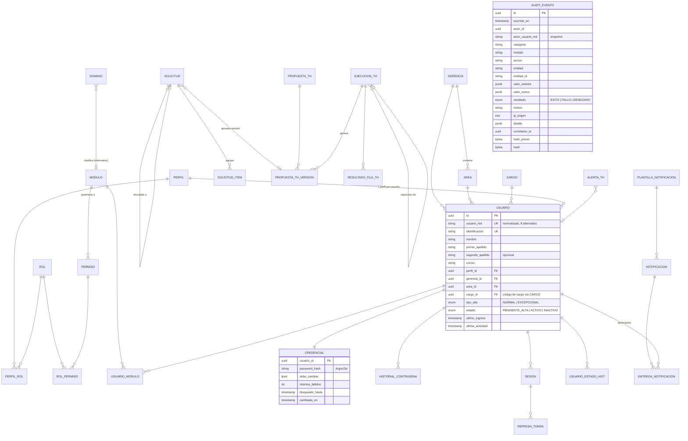

# D. Modelo conceptual de datos

> **PROPUESTA TÉCNICA A VALIDAR — no es el modelo físico aprobado** (P §12).
> Ninguna entidad contiene **Empresa** ni un campo equivalente (REQ-USER-03).
> Ninguna entidad conservable admite borrado físico; se usan `estado` y fechas de inhabilitación (regla 11).
> Convenciones (PD-14): PK `id` UUID v7; auditoría de fila con `creado_en`, `creado_por`, `modificado_en` y `modificado_por`; los catálogos usan un `codigo` estable.

## D.1 Diagrama (Mermaid ER)

## D.2 Catálogo de entidades y trazabilidad

### Esquema `app` — Identidad y organización

| Entidad | Atributos clave (además de los comunes) | Reglas / restricciones | Requisitos |
|---|---|---|---|
| **Usuario** | usuario_red (UK, normalizado en minúsculas), identificacion (UK), nombre, primer_apellido, segundo_apellido?, correo, perfil_id, gerencia_id, area_id, cargo_id, tipo_alta, estado, ultimo_ingreso, ultima_actividad | `area.gerencia_id = gerencia_id` (consistencia). `cargo_id` obligatorio (solo internos). Sin Empresa. Estados `PENDIENTE_ALTA`→`ACTIVO`↔`INACTIVO`; sin borrado. | REQ-USER-01..14, REQ-IAM-01, REQ-AUTH-01, REQ-AUTH-16 |
| **Credencial** | password_hash, debe_cambiar, intentos_fallidos, bloqueado_hasta, cambiada_en | 1:1 con Usuario, separada para que el hash nunca viaje en las consultas de usuario. El bloqueo no toca `Usuario.estado`. | REQ-AUTH-02,03,05,06,07 |
| **HistorialContrasena** | usuario_id, password_hash, creada_en | Se conservan las últimas 5 para validar la reutilización (o todas, ver PD-02). | REQ-AUTH-03 |
| **UsuarioEstadoHistorial** | usuario_id, estado_anterior, estado_nuevo, motivo, actor_id, solicitud_id?, ocurrido_en | Solo inserción. | REQ-USER-08, REQ-AUTH-10, REQ-TH-04 |
| **Gerencia** | codigo (UK), nombre, estado | Solo la escribe la sincronización TH. | REQ-USER-02, REQ-TH-13 |
| **Area** | codigo (UK), nombre, gerencia_id, estado | Cada área pertenece a una gerencia. | REQ-USER-06, REQ-TH-13 |
| **Cargo** | codigo_cargo (UK, numérico), nombre, estado | Relación cargo↔área: **PENDIENTE** (depende de las columnas TH, PD-09). Sin Cargo→Perfil (C-12). | REQ-USER-02,05, REQ-TH-13 |

### Esquema `app` — IAM

| Entidad | Atributos clave | Reglas | Requisitos |
|---|---|---|---|
| **Perfil** | codigo (UK), nombre, descripcion, estado, es_sistema | `es_sistema=true` para `ADMINISTRADOR` (protegido, máx. 2 usuarios activos; PD-06). No se inactiva con usuarios activos. | REQ-IAM-01,08, REQ-AUTH-12 |
| **Rol** | codigo (UK), nombre, descripcion, estado | — | REQ-IAM-01 |
| **PerfilRol** | perfil_id, rol_id, estado, asignado_en, asignado_por, inhabilitado_en? | Asociación histórica: se inhabilita, no se borra. | REQ-IAM-01,07 |
| **Permiso** | codigo (UK, `MOD.RECURSO.CATEGORIA`), nombre, descripcion, modulo_id (obligatorio), categoria, estado | Categoría ∈ {CONSULTA, CREACION, EDICION, ELIMINACION, APROBACION, EXPORTACION}. | REQ-IAM-06,07 |
| **RolPermiso** | rol_id, permiso_id, estado, asignado_en, asignado_por, inhabilitado_en? | Igual que PerfilRol. | REQ-IAM-01,04 |
| **Modulo** | codigo (UK: `ADM`, `IND`, …), nombre, descripcion, estado, orden (UK), ruta_frontend | `orden` es global (uniforme para todos). | REQ-IAM-10..13, REQ-GEN-04, REQ-IND-01 |
| **UsuarioModulo** | usuario_id, modulo_id, estado, asignado_en, asignado_por, revocado_en? | Habilita el acceso al módulo, no concede permisos. | REQ-IAM-10,11 |
| **Dominio** | codigo, nombre, descripcion, modulo_id?, estado | **Informativo**: ninguna regla de autorización lo consulta. | REQ-IAM-14 |

**Permisos efectivos** (vista o consulta, no tabla):
`Usuario(ACTIVO) → Perfil(ACTIVO) → PerfilRol(ACTIVO) → Rol(ACTIVO) → RolPermiso(ACTIVO) → Permiso(ACTIVO) → Modulo(ACTIVO)`, con `DISTINCT` y cruzado con `UsuarioModulo(ACTIVO)` (REQ-IAM-04, REQ-IAM-05).

### Esquema `app` — Sesiones (PD-01)

| Entidad | Atributos clave | Reglas | Requisitos |
|---|---|---|---|
| **Sesion** | usuario_id, iniciada_en, ultima_actividad, finalizada_en?, motivo_fin (LOGOUT, INACTIVIDAD, REEMPLAZADA, INHABILITACION, REVOCADA_ADMIN), ip, user_agent | Índice único parcial: una sola sesión con `finalizada_en IS NULL` por usuario. Redis guarda la copia "viva" con TTL. | REQ-AUTH-08,09,10,15,16 |
| **RefreshToken** | sesion_id, familia_id, token_hash (SHA-256), emitido_en, expira_en, usado_en?, revocado_en?, reemplazado_por? | Rotación en cada uso; si se reutiliza un token, se revoca toda la familia y la sesión. | REQ-AUTH-14 |

### Esquema `app` — Aprobaciones

| Entidad | Atributos clave | Reglas | Requisitos |
|---|---|---|---|
| **Solicitud** | numero (secuencial legible), tipo, origen (MANUAL/TH), entidad, entidad_id?, estado, solicitante_id (null si origen=TH), resuelta_por_id?, creada_en, resuelta_en?, motivo_resolucion?, solicitud_vinculada_id?, propuesta_version_id? | **Inmutable tras crearse**: solo cambian los campos de resolución. Autoaprobación permitida. | REQ-APR-01..09, REQ-USER-07, REQ-TH-03 |
| **SolicitudItem** | solicitud_id, atributo, valor_anterior (snapshot), valor_nuevo | Aplicación todo o nada; historial por atributo. | REQ-APR-03, REQ-AUD-08 |

Antes de aplicar, se compara el snapshot `valor_anterior` con el valor actual. Si otro cambio ya lo modificó, la aprobación falla con 409 (PROPUESTO, evita sobrescribir sin aviso).

### Esquema `app` — Integración TH (estructura de detalle bloqueada por PD-09)

| Entidad | Atributos clave | Requisitos |
|---|---|---|
| **EjecucionTH** | tipo (ACTIVA/RETIRADOS), archivo_sha256, nombre_archivo, tamano, recibido_en, cargado_por, estado (PENDIENTE, EN_PROCESO, COMPLETADA, PARCIAL, RECHAZADA, FALLIDA), intentos, proximo_intento_en, estadisticas (jsonb), ejecucion_origen_id?, motivo_reproceso?, archivo_eliminado_en | REQ-TH-01,02,07..10 |
| **ResultadoFilaTH** | ejecucion_id, fila, identificacion?, resultado (OK/ERROR/OMITIDA), errores (jsonb) | REQ-TH-07,08. **No** almacena columnas Empresa ni datos no necesarios. |
| **PropuestaTH** | id estable, tipo (NUEVO_FUNCIONARIO, CAMBIO_ORG, …), clave_negocio (identificación), estado | REQ-APR-07, REQ-TH-11 |
| **PropuestaTHVersion** | propuesta_id, version, ejecucion_id, contenido (jsonb), vigente | Solo la última vigente es aprobable. REQ-APR-07 |
| **AlertaTH** | tipo (USUARIO_AUSENTE, ARCHIVO_NO_RECIBIDO, DUPLICADO, REINTENTOS_AGOTADOS), usuario_id?, periodo_inicio, periodo_fin?, estado | Único por (tipo, usuario, periodo abierto), lo que garantiza una alerta por periodo continuo. REQ-TH-05,06 |

### Esquema `audit` (aislado; rol `audit_writer` solo con INSERT; PD-03)

| Entidad | Atributos | Requisitos |
|---|---|---|
| **Evento** | Ver D.1 (`AUDIT_EVENTO`). `hash = SHA-256(hash_previo ‖ contenido canónico)` | REQ-AUD-01..08 |

Protección: `REVOKE UPDATE, DELETE, TRUNCATE`, trigger `BEFORE UPDATE OR DELETE → RAISE` y cadena de hash verificable por un comando `audit verify`.

### Esquema `ops`

| Entidad | Atributos | Requisitos |
|---|---|---|
| **RegistroError** | id, ocurrido_en, categoria, modulo, componente, actor_id/proceso, tipo, severidad, descripcion, diagnostico (jsonb sin secretos), estado_atencion (ABIERTO, EN_ATENCION, CERRADO), correlation_id | REQ-ERR-01,02 |
| **Notificacion** | id, evento_origen (tipo + id auditoría), plantilla_id, asunto, cuerpo (sin datos sensibles), clave_dedupe (UK), creada_en | REQ-NOT-01..07 |
| **EntregaNotificacion** | notificacion_id, usuario_id, canal (BANDEJA/CORREO), estado (PENDIENTE, ENVIADA, FALLIDA, AGOTADA), intentos, proximo_intento_en, ultimo_error, leida_en? | REQ-NOT-03,04 |
| **PlantillaNotificacion** | codigo, asunto, cuerpo, estado | REQ-NOT-07 |
| **Parametro** | clave (UK), valor, tipo, descripcion, modificado_por | P. ej. `th.hora_habitual`, `th.umbral_alerta_horas=4`. REQ-TH-06, M §8.2 |
| **RegistroRespaldo** | tipo (DIARIO/SEMANAL/MENSUAL/MANUAL), inicio, fin, archivo, sha256, resultado, restaurado_en? | REQ-RNF-08 |

## D.3 Lo que este modelo **no** incluye a propósito

| Elemento | Motivo |
|---|---|
| Empresa (en cualquier forma) | REQ-USER-03, D-TH-002 |
| Permiso directo a usuario | REQ-IAM-02 |
| Cargo → Perfil | No aprobado (C-12, PD-15) |
| Estado `BLOQUEADO` / `RETIRADO` | C-09, C-15 |
| Expiración periódica de contraseña | REQ-AUTH-04 |
| Usuario ↔ Dominio | C-03 |
| Entidades KPI/KGI | REQ-IND-02 APLAZADO |
| Usuarios externos | REQ-USER-05 |
| Archivo TH binario | REQ-TH-08 (solo se guarda el hash) |
